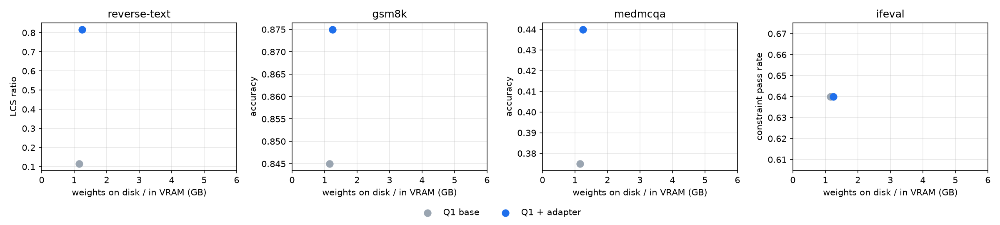

# One gigabyte, many skills: task adapters on a 1-bit 8B model, scored on Prime Intellect environments

*Draft, 2026-10-17. Every number is computed from the per-sample files in `results/` by
`harness/make_tables.py` and `harness/routers.py`.*

## Abstract

What is a 1-bit 8B model good for once it is given the cheapest specialization available? We
score PrismML's **Bonsai 8B** (`Q1_0`, 1.16 GB) on four **Prime Intellect Environments Hub**
environments — reverse-text, GSM8K, MedMCQA and IFEval — using each environment's own dataset,
prompt and reward code. Out of the box it trails a 4-bit **Qwen3-8B** (`Q4_K_M`, 5.03 GB) by 4–14
points, and at matched memory it beats or ties a 4-bit Qwen3-1.7B (GSM8K +0.05, MedMCQA −0.004 on
500 items). A rank-16 task adapter per environment (87 MB; 7–103 minutes on one laptop GPU; trained
from the environment's own rewards) adds **+0.70** on a skill neither base model has (reverse-text
0.82 vs 0.18 for the 4-bit 8B), +0.06 on MedMCQA, and nothing measurable where the base already
samples correct answers. A **72k-parameter recursive router (TRM)** picks the right adapter 99.8% of
the time from the prompt, and the routed four-skill library scores a macro 0.693 against 0.580 for
the 4-bit 8B — in 2.4 GiB of VRAM instead of 5.2 GiB — though on the three tasks the 4-bit model can already
do, it stays ahead. A lexical lattice router (LDT) used as a hard filter hurts, reproducing the
TRM/LDT hybrid result. The 1-bit model decodes 2.25× faster than the 4-bit 8B on the same GPU.
Finally, the public Qwen3-8B adapters we found **collapse when served with llama.cpp on the 4-bit
`Q4_K_M` GGUF** (MetaMathQA: GSM8K 0.98 → 0.37), yet the same adapter reproduces its author's number on
llama.cpp `Q8_0` (0.87) and on 4-bit NF4 in transformers+PEFT (0.85); adapters trained against Bonsai's
exact served weights show no such failure — a deployment hazard the 1-bit route avoids by
construction. The price of 1 bit: adapters cannot be merged into the weights, so an
active adapter roughly halves served throughput.

## 1. Question

A 4-bit 8B model is the usual "runs on a laptop" configuration: about 5 GB of weights. PrismML's
**Bonsai 8B** has end-to-end 1-bit weights — embeddings, attention, MLP and LM head — on the
Qwen3-8B dense architecture: `Q1_0` stores one sign bit per weight plus one FP16 scale per group of
128 (1.125 bits/weight, 1.16 GB). PrismML's model card reports GSM8K 88 and IFEval 79.8 (EvalScope
with vLLM on an H100; license Apache-2.0). A 1-bit model is weaker out of the box, so the question is not "is Q1 as good as Q4"
but **what Q1 buys once you add the cheapest specialization available — a small task LoRA — and how
that compares with the 4-bit model plus the adapters people already publish.**

We answer it on four public **Prime Intellect Environments Hub** environments, using each
environment's own dataset, prompt and reward code, so every number below is the score the Hub
environment would assign.

## 2. Setup

**Models.**
- *Q1*: `prism-ml/Bonsai-8B-gguf`, `Bonsai-8B-Q1_0.gguf` (1,158,654,496 bytes), served by PrismML's
  llama.cpp fork (build 10743).
- *Q4*: `Qwen/Qwen3-8B-GGUF`, `Qwen3-8B-Q4_K_M.gguf` (5,027,783,488 bytes), served by the same binary.
- *Q4, memory-matched*: `unsloth/Qwen3-1.7B-GGUF`, `Qwen3-1.7B-Q4_K_M.gguf` (1,107,409,472 bytes —
  the size of the 1-bit 8B), served by upstream llama.cpp b11269 (the fork's CUDA path crashed on it).
- *Q8 (diagnosis only)*: `Qwen3-8B-Q8_0.gguf` (8.71 GB), to separate adapter from quantization effects.

Servers ran 4–6 concurrent slots with 8k context each; from the 4-bit runs on, the host prompt cache
was capped at 1 GiB, and for the runs after the GPU resets (§5) the micro-batch at 128 tokens. Neither
changes the model; both change only how work is batched, which can shift floating-point rounding.

Both use the same Qwen3 chat template (taken from the Bonsai checkpoint), which always closes an
empty `<think>` block — i.e. non-thinking mode for every configuration — so prompts are
byte-identical across models.

**Environments** (installed from the Hub index; scored by their own reward functions):

| Hub env | eval set | score |
|---|---|---|
| `primeintellect/reverse-text` | last 200 of the env's 1,000 rows (first 800 = train) | LCS ratio of parsed `<reversed_text>` |
| `primeintellect/gsm8k` | first 200 of GSM8K test | math-verify on `#### N` |
| `maziyar/OpenMed_MedMCQA` | first 200 of the env's validation split | boxed-letter accuracy |
| `arcee-ai/ifeval` | the env's own seeded 200-row holdout | RLVR-IFEval constraint pass rate |

Implementation notes: the three classic-API envs require `verifiers<0.4` (0.4.0 removed
`vf.Environment`); `primeintellect/gsm8k` is a verifiers-v1 taskset whose `verify.py` we run
in-process with math-verify's signal/process timeouts disabled (on Windows they spawn a child that
cannot re-run the script and every answer scores 0) — the scoring logic is otherwise line-for-line.

**Sampling.** Qwen3's recommended non-thinking settings (T = 0.7, top-p 0.8, top-k 20), one sample
per eval example with a per-example seed shared by all configurations, so comparisons are paired.
Max new tokens: 384 (reverse-text), 768 (gsm8k), 1024 (medmcqa, ifeval).

**Adapters.**
- *Ours (Bonsai)*: rank-16 LoRA on all seven projections (43.6 M parameters; 87 MB as an f16 GGUF),
  trained with QLoRA on `prism-ml/Bonsai-8B-unpacked` in 4-bit NF4 — whose weights are an exact
  expansion of the 1-bit release, so the adapter applies unchanged to `Q1_0` (we verified
  byte-identical generations between the torch 4-bit path and the 1-bit server in prior work).
  Training signal comes from the environment itself: for reverse-text the env's gold reversal
  (Prime Intellect's own SFT warm-up shape); for gsm8k, medmcqa and ifeval, **rejection-sampling
  fine-tuning** — sample 4 completions per prompt for 400 train prompts from the base 1-bit model,
  keep up to two distinct completions the env scores as fully correct, fine-tune on them.
- *Online (Qwen3-8B)*: the best-matching public LoRAs on the Hub, used as published (not trained by us):
  `Pradheep1647/qwen3_8b_gsm8k_unloth_trl` (GRPO on GSM8K) and `tianzl66/Qwen3-8B-MetaMathQA-50K-LoRA`
  for gsm8k; `vireshk/qwen3-8b-medmcqa-qlora` for MedMCQA; `tianzl66/Qwen3-8B-InstructionFollowing-LoRA`
  (Tulu-3 IF split) for IFEval. All are rank 16 on all seven projections — the same shape as ours.
  No public adapter exists for reverse-text. (The most-downloaded "GSM8K LoRA",
  `swagger00/Qwen3-8B-GRPO-GSM8K`, ships merged 16 GB weights, not an adapter, and was excluded.)

**Serving.** One llama-server per base model with every adapter loaded at start
(`--lora-init-without-apply`) and switched per run through `/lora-adapters` — the deployment
pattern where one small base serves many skills.

**Routers.** A skill library needs a router. Following the TRM/LDT split of Dugan (2026,
*Trade-offs between TRM/LDT hybrids*), we compare a **TRM** — a tiny recursive classifier
(72k parameters: hashed word/bigram/char-trigram features, a latent *z* and answer state *y*
refined by two weight-shared 2-layer MLPs, 3 inner × 3 outer steps, deep supervision) — with an
**LDT** lexical lattice (each known word carries the candidate set of envs it occurs in; a
prompt's state is the meet over its words; the empty set is bottom), and the paper's hybrid control
policies: soft (lattice as telemetry), hard filter, confidence arbitration, and a typed membrane
that **abstains to the base model** when the TRM's proposal conflicts with the lattice. Routers are
trained on 800 train prompts per env and scored on the 800 eval prompts in two views: the full
prompt as the env sends it, and the user's content with the env's instruction scaffolding removed.
Besides routing accuracy we report **end-to-end** score: the env score of the answer the 1-bit model
actually produced under the chosen adapter (all adapter × env answers are generated, so this is a
lookup, not a model of the outcome).

## 3. Results

### 3.1 The whole picture

Same 200 eval items per environment for every column (paired, same seeds); weights are file sizes:

| env (score) | Q4 Qwen3-1.7B (1.11 GB) | Q1 Bonsai 8B (1.16 GB) | Q1 + our adapter (+87 MB) | Q1 + online Qwen3 adapter | Q4 Qwen3-8B (5.03 GB) | Q4 8B + best online adapter | Q4 8B + our Bonsai adapter |
|---|---|---|---|---|---|---|---|
| reverse-text (LCS) | 0.079 | 0.115 | **0.817** | — | 0.178 | — | 0.093 |
| gsm8k (accuracy) | 0.800 | 0.845 | 0.875 | 0.870 | **0.945** | 0.425 | 0.940 |
| medmcqa (accuracy) | 0.425 | 0.375 | 0.440 | 0.420 | **0.515** | 0.475 | 0.510 |
| ifeval (pass rate) | 0.590 | 0.640 | 0.640 | 0.630 | **0.680** | 0.375 | 0.660 |
| **macro** | 0.474 | 0.494 | **0.693**¹ | — | 0.580 | 0.363² | 0.551 |

¹ With each prompt routed to its adapter — exactly what the 72k-parameter TRM router achieves on
full prompts (§3.5). ² Using the Q4 base for reverse-text, where no public adapter exists.

GSM8K and MedMCQA, extended to 500 items (paired bootstrap 95% CIs):

| env | Q4 1.7B | Q1 base | Q1 + our adapter | Q4 8B | Q1 + adapter vs Q1 | Q1 vs Q4 1.7B | Q1 + adapter vs Q4 1.7B | Q1 + adapter vs Q4 8B |
|---|---|---|---|---|---|---|---|---|
| gsm8k | 0.802 | 0.854 | 0.868 | 0.938 | +0.014 [−0.014, +0.044] | **+0.052** [+0.014, +0.088] | **+0.066** [+0.032, +0.102] | **−0.070** [−0.096, −0.046] |
| medmcqa | 0.392 | 0.388 | 0.450 | 0.518 | **+0.062** [+0.018, +0.108] | −0.004 [−0.048, +0.044] | **+0.058** [+0.010, +0.106] | **−0.068** [−0.122, −0.014] |



*Score against weight size, 200-item values. On MedMCQA the 200-item sample puts the 4-bit 1.7B above
the 1-bit base (0.425 vs 0.375); on 500 items they tie (0.392 vs 0.388).*

Three regimes, read off the table:

- **At equal memory (~1.1–1.25 GB), the 1-bit 8B is the better model.** It beats the 4-bit
  Qwen3-1.7B on GSM8K (+0.05, significant at n = 500), reverse-text (+0.04) and IFEval (+0.05,
  borderline), ties on MedMCQA, and with its adapters leads everywhere.
- **At equal parameters, the 4-bit 8B is the better model** on everything its base already does
  (GSM8K, MedMCQA, IFEval: +0.04 to +0.14 over the 1-bit base), and the self-distilled adapters do
  not close that gap.
- **Where a task needs a skill, an adapter beats parameters.** Reverse-text is a learnable
  transformation neither base performs; the 87 MB adapter takes the 1-bit model to 0.82, 0.64 above
  the 4-bit 8B, and is what puts the routed 1-bit library ahead on the macro average.

### 3.2 What an 87 MB adapter buys on the 1-bit base

Paired deltas over the same 200 examples and seeds (bootstrap 95% CI):

| env | Q1 base | Q1 + our adapter | Δ | what the adapter learned |
|---|---|---|---|---|
| reverse-text | 0.115 | **0.817** | **+0.702** [+0.682, +0.722] | the task itself: the base reorders words instead of reversing characters and runs past the 384-token cap on half the items (mean 205 tokens, 49% truncated); with the adapter, 51 tokens, 0% truncated |
| gsm8k | 0.845 | 0.875 | +0.030 [−0.020, +0.075] | sharpening only — self-distillation on its own correct answers (loss 0.12 → 0.08); on 500 items +0.014 [−0.014, +0.044] |
| medmcqa | 0.375 | 0.440 | +0.065 [−0.005, +0.135] | real but modest: on 500 items 0.388 → 0.450, **+0.062 [+0.018, +0.108]** |
| ifeval | 0.640 | 0.640 | 0.000 [−0.045, +0.040] | nothing measurable |

The pattern is what one would predict for rejection-sampling fine-tuning: it can only amplify
behaviour the base already samples. Where the base is far from the task (reverse-text) a few
hundred gold examples move it by 0.7; where it already samples correct answers most of the time
(gsm8k 91% of training samples correct) there is little left to amplify.

**Training cost** (RTX 5080 Laptop, 16 GB; the QLoRA job sat at the VRAM limit, so these are
upper bounds):

| adapter | data | sampling (Q1 server) | training | total |
|---|---|---|---|---|
| reverse-text | 800 env gold reversals | — | 7 min (150 steps) | 7 min |
| gsm8k | 757 of 1,600 samples correct | 17 min | 50 min (96 steps) | 67 min |
| medmcqa | 465 of 1,600 | 16 min | 60 min (60 steps) | 76 min |
| ifeval | 479 of 1,600 | 23 min | 80 min (60 steps) | 103 min |

### 3.3 Public Qwen3-8B adapters run on the 1-bit model

Bonsai shares Qwen3-8B's architecture, so rank-16 LoRAs trained on Qwen3-8B load onto the 1-bit
weights unchanged. They change every output (0/200 texts identical to base on gsm8k and medmcqa,
33/200 on ifeval) but their effect is within noise at n = 200: gsm8k GRPO adapter +0.025
[−0.025, +0.075], MetaMathQA −0.005, MedMCQA adapter +0.045 [−0.030, +0.120], Tulu IF adapter
−0.010 [−0.050, +0.025]. They neither break the 1-bit model nor reliably help it.

### 3.4 Adapters are narrow — and one is dangerous off-task

Every adapter on every env (1-bit base, 200 examples per cell; rows = env, columns = adapter):

| env | no adapter | reverse-text | gsm8k | medmcqa | ifeval |
|---|---|---|---|---|---|
| reverse-text | 0.115 | **0.817** | 0.131 | 0.133 | 0.135 |
| gsm8k | 0.845 | **0.045** | **0.875** | 0.850 | 0.875 |
| medmcqa | 0.375 | **0.250** | 0.370 | **0.440** | 0.340 |
| ifeval | 0.640 | **0.330** | 0.645 | 0.630 | **0.640** |

The three self-distilled adapters are close to harmless off-task. The reverse-text adapter — the
one that learned a genuinely new behaviour — destroys the others (gsm8k 0.845 → 0.045: it starts
reversing). A skill library on one base is therefore only as good as its router.

### 3.5 Routing the library: TRM, LDT and hybrids

End-to-end macro score (mean over the four envs of the score of the answer actually produced under
the routed adapter; 800 prompts, TRM averaged over 5 seeds):

| router | full prompt: routing acc | full: end-to-end | content only: routing acc | content: end-to-end |
|---|---|---|---|---|
| oracle (true env's adapter) | 1.000 | 0.693 | 1.000 | 0.693 |
| no adapter (base) | — | 0.494 | — | 0.494 |
| best single adapter for everything (medmcqa) | — | 0.513 | — | 0.513 |
| **TRM** (72k parameters) | 0.998 | **0.693** | 0.865 | **0.615** |
| LDT alone (lexical lattice; bottom → base) | 0.305 | 0.506 | 0.305 | 0.507 |
| hard-filter hybrid | 0.935 | 0.693 | 0.683 | 0.553 |
| soft hybrid / confidence arbitration / membrane (γ by CV) | = TRM | 0.693 | = TRM | 0.615 |
| membrane, abstain threshold tuned end-to-end (cross-fitted) | 0.998 | 0.693 | 0.862 | 0.613 |
| TRM + expected-utility over the cross-task matrix (cross-fitted) | 0.643 | 0.684 | 0.570 | 0.603 |

Findings, which replicate the routing ablation of the TRM/LDT hybrid paper on a new problem:

1. **A 72k-parameter TRM is enough when the prompt carries the task**: it matches the oracle
   (0.693), turning four 87 MB adapters into +0.20 macro score over the base model, while no single
   adapter gets more than +0.02.
2. **Lexical lattice evidence is too noisy to filter with.** The LDT alone reaches bottom on most
   prompts (abstains 43–63%), and using it as a hard filter costs 0.06 end-to-end on content-only
   prompts — the same failure mode as the paper's routing benchmark (0.584 vs 0.815). As soft
   telemetry it is harmless and inert.
3. **Abstention does not rescue content-only routing here.** The errors are bare sentences
   (reverse-text items) routed to other adapters, and for those the base model is no better than a
   wrong adapter (0.115), so abstaining gains nothing; the costly error (a math problem sent to
   the reverse-text adapter) is rare (8/200). Expected-utility routing over the measured cross-task
   matrix is *worse* (0.603): off-task, three adapters are near-ties, and the decision chases noise
   in the estimated matrix.

### 3.6 Against the 4-bit 8B

Paired deltas, 1-bit Bonsai + our adapter minus 4-bit Qwen3-8B (200 examples, bootstrap 95% CI):

| env | Q1 + adapter (1.25 GB) | Q4 8B base (5.03 GB) | Δ vs Q4 base | Q4 8B + best online adapter | Δ vs Q4 + online |
|---|---|---|---|---|---|
| reverse-text | **0.817** | 0.178 | **+0.639** [+0.605, +0.672] | — (none exists) | — |
| gsm8k | 0.875 | **0.945** | **−0.070** [−0.110, −0.030] | 0.425 (MetaMathQA) | +0.450 [+0.375, +0.525] |
| medmcqa | 0.440 | **0.515** | −0.075 [−0.160, +0.015] | 0.475 (vireshk) | −0.035 [−0.120, +0.050] |
| ifeval | 0.640 | **0.680** | −0.040 [−0.090, +0.010] | 0.375 (Tulu IF) | +0.265 [+0.195, +0.340] |

Read honestly, this is two results:

1. **On what the base models already know, the 4-bit 8B is better.** Bonsai at 1 bit trails
   Qwen3-8B at 4 bits by 4–14 points on math (0.845 vs 0.945), medical knowledge (0.375 vs 0.515)
   and instruction following (0.640 vs 0.680), and a self-distilled adapter narrows but does not
   close that gap: at n = 500 the adapted 1-bit model is still −0.070 [−0.096, −0.046] on GSM8K and
   −0.068 [−0.122, −0.014] on MedMCQA; IFEval −0.04 is within noise at n = 200.
2. **A trained skill beats the bigger model where neither base has it.** On reverse-text the 87 MB
   adapter puts the 1-bit model 0.64 above the 4-bit 8B — at a quarter of the memory.

**The community adapters hurt the model they were trained for — on llama.cpp `Q4_K_M`.** Every public Qwen3-8B adapter
lowers the 4-bit Qwen3-8B, two of them catastrophically: the GSM8K GRPO adapter loops after
`#### N` until the token cap (0.945 → 0.25, 200/200 truncated; reproduced with upstream llama.cpp on
CPU, so not a fork artefact), the MetaMathQA adapter stutters ("glasses glasses") (→ 0.425; its
author reports 0.840 with bf16 weights, vLLM, greedy decoding), and the Tulu IF adapter drops ifeval
from 0.68 to 0.375 (31/200 answers with a repeated word vs 7/200 for the base; its author reports
IFEval prompt-strict 0.743). The same adapters are neutral on the 1-bit model, and *our* Bonsai
adapters are harmless on the 4-bit Qwen3-8B except reverse-text (gsm8k 0.940, medmcqa 0.510,
ifeval 0.660 vs 0.945 / 0.515 / 0.680) — so llama.cpp's LoRA path on Q4_K_M is not broken in
general.

**It is the `Q4_K_M` serving path.** A controlled grid (100 items each; same server binary, same
prompts; `results/diagnostics/`):

| | Qwen3-8B Q4_K_M (5.0 GB) | Qwen3-8B Q8_0 (8.7 GB) |
|---|---|---|
| base, greedy | 0.98 | 0.97 |
| + MetaMathQA LoRA, greedy | **0.37** — 36% hit the 768-token cap, 7/100 stutter | **0.87** — 0% capped, 0 stutter, 121 tokens (MetaMath's terse style) |
| + MetaMathQA LoRA, env sampling | 0.38 | 0.84 |
| + Tulu IF LoRA (ifeval), env sampling — base 0.67 on these items | 0.41 — 16/100 stutter | 0.54 — 3/100 stutter |

At Q8_0 the MetaMathQA adapter reproduces its author's own number (0.84, bf16 vLLM) to within noise;
the *identical* adapter file on the *identical* model at Q4_K_M loses half its accuracy and its
trained answer style. Greedy decoding does not rescue it, so this is not a sampling artefact, and
the base model at Q4_K_M is fine (0.98), so it is not the quantization alone.

**And it is not 4-bit weights as such.** Outside llama.cpp — real Qwen3-8B safetensors loaded in
4-bit NF4 by bitsandbytes, the adapter applied by PEFT exactly as published, greedy, same 60 GSM8K
prompts (`harness/peft_check.py`, `runs/peft/`) — the base scores 0.967 and **+ MetaMathQA 0.85 with no
stutter**, matching its author and llama.cpp Q8_0. The failure is specific to the llama.cpp `Q4_K_M`
GGUF + GGUF LoRA path, which is also the most common way to run a 4-bit model with an adapter
locally. We saw it on the CUDA backend and, for the GRPO adapter, on the CPU backend of upstream
llama.cpp too. We did not isolate the mechanism; one difference worth testing is that `Q4_K_M`
also quantizes the token embeddings and output layer, which NF4 leaves in bf16. (The GRPO adapter
is additionally defective on its own: it never learned to stop, and loops after the answer on every
backend — NF4 included, where the loop usually starts after a complete `#### N` line so it still
scores 0.833; on `Q4_K_M` the loop continues the number itself, "#### 3333…", and scores 0.25.)

(On the 1-bit Bonsai —
whose weights the adapter never saw — the same adapter is simply inert: 0.84 greedy on these 100
items, against a base of 0.854 with env sampling on 500.) Our
own Bonsai adapters, trained against the exact weights they are served on, show no such failure.

This is a deployment hazard the 1-bit route avoids by construction. Bonsai's training checkpoint
(`Bonsai-8B-unpacked`) is an exact expansion of the served `Q1_0` weights, so a QLoRA trained on it
is trained against precisely the numbers it will run on, in the runtime it will run in. The usual
local 4-bit route — download a bf16 community LoRA, serve it with llama.cpp on the popular `Q4_K_M`
GGUF — has no such guarantee. Relative to each base:
the MetaMathQA adapter costs 0.61 at Q4_K_M but 0.10 at Q8_0; the Tulu IF adapter costs 0.26 at Q4_K_M
and about 0.13 at Q8_0 (measured against the Q4_K_M base, 0.67 on these items; no Q8_0 ifeval base was
run) — a weak adapter for this env either way. The safe practice is to validate a community adapter
on the exact quantization and runtime it will be served on; with llama.cpp that means `Q8_0` (8.7 GB,
giving back most of the memory advantage over 1.25 GB for Q1 + adapter) or a non-K-quant path.

### 3.7 Systems: memory and speed

llama-bench, PrismML fork build 10743, RTX 5080 Laptop (16 GB) / Ryzen AI 9 365:

| model | weights | GPU decode (tg128) | GPU prefill (pp512) | CPU decode (tg32, -ngl 0) |
|---|---|---|---|---|
| **Bonsai 8B Q1_0** | **1.15 GB** | **200.6 tok/s** | 4,949 tok/s | **17.7 tok/s** |
| Qwen3-8B Q4_K_M | 5.02 GB | 89.1 tok/s | 3,137 tok/s | 11.1 tok/s |
| Qwen3-1.7B Q4_K_M | 1.10 GB | 319.5 tok/s | 16,362 tok/s | 51.8 tok/s |

At equal parameter count the 1-bit model decodes **2.25× faster on the GPU and 1.6× faster on the CPU**
than the 4-bit one, from 4.4× less weight memory — decode is memory-bandwidth-bound, and the 1-bit
weights are a quarter of the bytes.

**The cost: adapters cannot be merged into 1-bit weights.** A 4-bit model can absorb a LoRA by
merging it into fp16 weights and re-quantizing; a 1-bit model cannot (the sum is no longer ±scale),
so on Q1 every adapter runs as a separate low-rank product. Served throughput with one active
adapter fell from ~390 to ~160–185 aggregate tok/s (6 concurrent requests). This is the price of the
1-bit footprint, and the reason the skill-library pattern — many adapters loaded, one active per
request — is the natural deployment for Q1 rather than a merged specialist.

**Deployment footprint** (llama-server, one slot, 4k context; VRAM measured as the `nvidia-smi`
delta when the server starts, RAM as its working set; `results/memory.json`):

| server | VRAM | process RAM |
|---|---|---|
| Q1 Bonsai 8B | **1.87 GiB** | 1.42 GiB |
| Q1 Bonsai 8B + all four adapters loaded | **2.37 GiB** | 1.55 GiB |
| Q4 Qwen3-8B | 5.23 GiB | 4.78 GiB |
| Q4 Qwen3-8B + four adapters | 5.73 GiB | 4.91 GiB |
| Q4 Qwen3-1.7B | 1.73 GiB | 1.44 GiB |

The whole four-skill 1-bit library, router included (72k parameters, negligible), runs in less VRAM
than the 4-bit 8B base alone needs — within the budget of a 4 GB GPU, where the 4-bit 8B does not
fit at all.

## 4. What Q1 buys — and what it does not

- **Buy it for a skill library at a fixed small memory budget.** At ~1.2 GB the 1-bit 8B is the
  stronger base (vs the 4-bit 1.7B), it is the faster 8B (2.25× decode), and it takes cheap
  per-task adapters that a 72k-parameter router can dispatch. Where the deployment needs behaviours
  — formats, transformations, house styles — rather than more world knowledge, this is a better use of
  1.2 GB than a smaller 4-bit model.
- **Do not buy it for knowledge.** If memory allows the 4-bit 8B, it is 4–14 points better on what
  both models already know, and self-distilled adapters do not close that gap.
- **Train adapters against the weights you serve.** The 1-bit route gets this for free (the unpacked
  checkpoint is the served model, bit for bit). The common 4-bit route — bf16 community LoRA on a
  `Q4_K_M` GGUF in llama.cpp — cost three of the four public adapters we tried 0.26–0.70 of task score;
  the cleanest case (MetaMathQA) works at `Q8_0` and at 4-bit NF4 in transformers+PEFT, so the hazard is
  the specific runtime/quantization pair, not 4 bits. Validate community adapters on the exact serving
  stack, or retrain them against the weights you serve.
- **Route; never apply a skill adapter blindly.** The one adapter that learned a new behaviour is
  catastrophic off-task (reverse-text adapter on GSM8K: 0.045). A tiny TRM routes full prompts
  perfectly; on bare content it reaches 86.5% and loses 0.08 of the oracle's macro score, so
  deployments should keep the task signal in the prompt.
- **Budget for unmerged adapters.** Q1 cannot fold an adapter into its weights; an active adapter
  roughly halved served throughput here.

## 5. Limitations

- **Small eval sets.** 200 items per environment (500 for GSM8K and MedMCQA), one sample per item;
  several differences are within noise and are reported as such. Sampling follows Qwen3's
  non-thinking recommendation for every model; thinking mode was not evaluated. PrismML's own
  GSM8K/IFEval numbers come from a different harness and dataset version (their IFEval is the Google
  benchmark; ours is the Hub env's RLVR-IFEval holdout), so they are not directly comparable.
- **One adapter recipe.** Rejection-sampling fine-tuning from the base's own samples can only
  amplify what the base already does; RL against the environment reward (what the Prime Intellect
  stack is built for) or distillation from a stronger model would likely do more on GSM8K and IFEval.
- **Few public adapters.** Four were found that match these environments' shapes; their quality
  varies (the Tulu IF adapter is weak at any precision; the GRPO adapter never learned to stop). The
  llama.cpp `Q4_K_M` collapse is shown cleanly for one adapter (MetaMathQA, controlled against `Q8_0`
  and against NF4 + PEFT) and partially for a second (Tulu IF); we did not isolate its mechanism, and
  the NF4 check used 60 items.
- **One machine, noisy conditions.** An RTX 5080 Laptop shared with other jobs at times. Served
  throughput numbers were taken under that sharing and under a software power cap that later caused
  Windows TDR GPU resets; the speed table uses isolated `llama-bench` runs instead. The PrismML fork
  crashed on Qwen3-1.7B, so that model was served by upstream llama.cpp (build b11269); interrupted
  runs were resumed per item, and partial files from the crashed binary were discarded.
- **Router data.** Prompts from four environments are easy to separate when the instructions are
  kept; the content-only view is the harder, more realistic case, and the routers were not tested on
  out-of-distribution traffic.

## 6. Reproducing

```
# environments venv (verifiers<0.4 + the four Hub env packages) and the torch venv (QLoRA)
python harness/generate.py --env gsm8k --split eval --label q1-base --out results/gsm8k/q1-base
python harness/export_gold.py --env reverse-text --out runs/sft/reverse-text-gold.jsonl
python harness/generate.py --env gsm8k --split train --n 400 --k 4 --seed 1 --label q1-base-rft --out runs/rft/gsm8k-q1-base
python harness/train_lora.py --env gsm8k --data runs/rft/gsm8k-q1-base.jsonl --min-score 1.0 --per-prompt 2 --out <dir>
python harness/routers.py
python harness/make_tables.py
```

The phase scripts (`harness/phase{A,B,C,D,E,X,M}.ps1`) record the exact server configurations. All
per-sample generations and scores are in `results/`; adapter weights are kept outside the repository.
